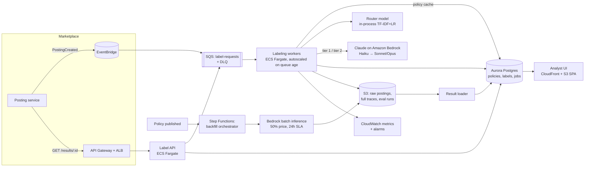

# DESIGN — full version (details behind ../DESIGN.md)

The long form of [DESIGN.md](../DESIGN.md): same section numbers, with the full
arguments and tables. Read DESIGN.md first.

## The decisions that shape everything else

1. **The model proposes, code decides.** The LLM reports which policy sections
   match and quotes the posting. Code verifies every quote against the posting
   text, drops sections without verifiable evidence, and computes the label from
   each section's `effect` as written in the policy. A label can therefore always
   be explained by quotes that really exist, and a policy author can predict how a
   section will combine with others without reading a prompt.
2. **The policy is a versioned document, not a prompt.** Sections, their text,
   their effect (`violating` / `review_only`) and the edge cases live in YAML. The
   system prompt, the JSON output schema (the enum of allowed section ids) and the
   aggregation rule are all generated from it at run time. Publishing a new version
   is a data change.
3. **Labels are keyed by `(job_id, policy_version)`.** Versions never overwrite
   each other. A new version can be shadow-run next to the published one, compared
   posting by posting, published, and rolled back by re-publishing the old row.
4. **Cheap model on everything, strong model only where it pays.** A small model
   labels every posting; specific, logged triggers escalate to a larger model.
5. **Failure is a label, not an exception.** If the model is unavailable, the
   posting becomes `NEEDS_REVIEW` with confidence 0 and a visible reason. Nothing
   is silently dropped and nothing is silently allowed.

## 1. Architecture



| Component | Service | Why |
|---|---|---|
| Ingest | EventBridge → **SQS** (standard, DLQ after 3 receives) | Decouples the marketplace from model latency and absorbs the 5× peak; the DLQ makes poison messages visible. |
| API | **API Gateway + ALB + ECS Fargate** (FastAPI, the code in this repo) | Sync single-posting endpoint for tools/tests, async batch, results lookup, policy management. |
| Workers | **ECS Fargate** service, target-tracking on `ApproximateAgeOfOldestMessage` | LLM calls are I/O-bound: one task runs ~50 concurrent calls with asyncio. No GPUs needed. |
| Models | **Claude on Amazon Bedrock** (Haiku tier 1; Sonnet or Opus tier 2) | Data stays in the AWS account, IAM auth, provisioned throughput available when on-demand quotas run out. The repo calls the Anthropic API directly; the provider is one class. |
| Router | scikit-learn model loaded **in the worker** (~5 MB) | Sub-millisecond, no extra network hop. Retrained offline; versioned in S3. |
| State | **Aurora Postgres** | Policies, labels (`job_id, policy_version` PK), jobs. Analyst filters are indexed SQL (sections are a table, not JSON). The repo runs the same schema on Postgres via Alembic. |
| Traces | **S3** (Parquet, partitioned by day and version), Athena | Full prompts/outputs are large and rarely read: keep a pointer in Postgres. |
| Backfill | **Step Functions** + **Bedrock batch inference** | Re-labeling is not latency-bound, so it uses the half-price batch path and never competes with live traffic for quota. |
| UI | Static SPA on **CloudFront**, Cognito auth | Analysts' tool. |
| Ops | CloudWatch metrics + alarms, X-Ray on the API | See §5. |

**Data flow for one posting.** Event → SQS → worker loads the published policy
(cached, invalidated by a `PolicyPublished` event) → signals + router →
tier-1 call → verify → maybe tier-2 → write label → emit `PostingLabeled`
(the marketplace subscribes to act on `VIOLATING`). The marketplace can also
poll `GET /results/{job_id}`.

### Secrets (API keys)

The app reads keys through one port (`core/labeler/infra/secrets/port.py`) with
three adapters:
- **AWS:** Secrets Manager under `policy-labeler/*`, KMS-encrypted. ECS task roles get
  `secretsmanager:GetSecretValue` on that prefix only, and every read is in CloudTrail.
  Rotation is a new secret version, which workers pick up within seconds, with no redeploy.
  A worker whose tier has no usable key heartbeats as *waiting* and takes no messages, so a
  missing or revoked key leaves work queued instead of failing it.
  In production the Settings page should only *test* keys; setting them belongs to
  infrastructure-as-code or an admin role. With Bedrock there is no model key at all, only IAM.
- **Local and compose:** a key typed on the Settings page is encrypted (Fernet) before it
  reaches Postgres. The master key comes from `SECRETS_KEY`, or is generated once into
  `data/secrets.key` (mode 0600, gitignored, shared with workers through the `./data` mount).
- **Either:** `.env` and environment variables still work and are the fallback. The API never
  returns a key, only its source and last four characters. `.env` is gitignored, and gitleaks
  runs in pre-commit and CI.

## 2. Scaling

**Steady state and peak.** 200k/day is 2.3 postings/s; the 5× peak is ~12/s.
With a tier-1 latency of a few seconds (see RESULTS.md for measured p50/p95),
peak needs ~50–60 calls in flight: two or three worker tasks. The 60 s / p95
target leaves room for queueing: autoscaling on queue *age* (not depth) keeps
the age under ~20 s. Tier-2 calls are slower but rare.

**Token throughput is the real limit**, not compute. Each posting is ~1.7k input
tokens (≈920 of instructions+policy that are identical across postings and
served from the prompt cache, ≈800 of posting) and a few hundred output tokens.
At peak that is ~1.5–2M tokens/minute on tier 1. That fits a raised Bedrock
quota, but it is the number to negotiate first.

**Backfill after a policy change.** 30 days ≈ 6M postings, weekly. Three rules:
1. **Never on the live path.** Backfills go through batch inference (half price,
   its own quota). Live traffic is labeled with the new version from the moment
   of publishing; the backfill catches up behind it.
2. **Shadow first, then publish.** A new version is first run on the fixed eval
   set and a stratified sample of recent traffic (a few thousand postings,
   minutes, a few dollars). Publishing is a decision made with that diff in hand.
3. **Re-label only what the change can affect** (design, not built): if a version
   only *adds* a `violating` section, postings already `VIOLATING` cannot change
   label, only gain a section. If it only rewrites one section's text, postings
   whose previous run did not consider that section borderline can be skipped
   after a cheap per-section check. This typically removes most of the 6M.
   Postings that would flip from `VIOLATING` to `ALLOWED` are queued for analyst
   confirmation instead of being auto-unblocked.

**10× growth (2M/day, ~120/s peak).** What breaks, in order:
1. **Model quota** (~15–20M tokens/min on tier 1). Mitigations: Bedrock
   provisioned throughput; cross-region inference profiles; and, the structural
   fix, a **distilled small model** fine-tuned on tier-1/tier-2 outputs, served
   on our own GPUs (e.g. a 3–8B model on a few g6 instances). It reads the same
   policy text and emits the same schema, so verification and aggregation stay
   unchanged; the hosted model becomes the escalation tier.
2. **Backfill window.** 60M postings per policy change no longer fits a
   week of batch quota, so the "re-label only what can change" rule becomes
   mandatory, not optional.
3. **Postgres write rate** (~25 writes/s average plus backfills) is still fine
   for Aurora; trace volume moves entirely to S3.
4. Workers and API scale horizontally and are not the bottleneck.

### The human queue

**The human queue breaks before any machine does.** On the eval set, 35% of
decisions go to review, and §5 alone sends 89 of 300 legitimate postings there
(RESULTS.md §1.1). The eval set is enriched to 25% fraud. At EMSCAD's base rate
of 4.8%, that becomes ≈ 0.95 × 30% (legitimate) + 0.05 × 51% (fraud) ≈ **31% of
traffic, about 60k postings a day**. At an assumed minute per case, that is
≈ 1,000 analyst-hours a day. Nothing in the model tier fixes that. The levers, in order:
1. **Policy: narrow §5** (`policies/v3.yaml`: "unverifiable" only when the posting
   never says who is hiring), measured on development data before publishing.
2. **Order the queue by router risk, and sample the tail.** On the eval run, a
   router score ≥ 0.3 keeps 50 of 51 frauds in review and moves 49 of 140 cases
   (48 of them legitimate) to a sampled low-priority lane. The router leaks on
   eval (§1 of RESULTS), so this must be re-measured on live traffic.
3. **Send §5-only cases to the poster, not an analyst.** Ask them to complete the
   company profile or verify the employer. It is the same signal, handled by the
   party who can resolve it.
4. **Thresholds are settings.** The escalation confidence and the router
   threshold are on the Settings page. Every change is shadow-run first, because
   each one trades analyst load against missed fraud.

Staffing is a product decision. The design makes the trade-off visible and
adjustable per version.

## 3. Cost

Prices are list prices per 1M tokens (input / output): Haiku 5.5 $0.10/$0.50,
Sonnet 5.5 $2/$10, Opus 5.5 $4/$20. Cache reads bill at 10% of input. Token
counts per call, **measured on the 400-posting eval run** (RESULTS.md §6):
≈920 cached system tokens, ≈800 posting tokens, and output (JSON + thinking)
of ≈820 on Haiku and ≈580 on Opus. That gives, per 1,000 calls: **Haiku
≈ $0.50, Sonnet ≈ $7.6, Opus ≈ $15.2**. The table is built from those so it
can be checked by hand; monthly = 6M postings, backfill = 4 × 6M at batch
price (−50%).

| Option | Per 1,000 postings | Live, per month (6M) | + weekly 30-day backfill |
|---|---|---|---|
| **A. Large model on everything** (Opus 5.5, no cascade) | ≈ $15 | ≈ $91k | +$183k |
| **B. Mid model on everything** (Sonnet 5.5) | ≈ $7.6 | ≈ $46k | +$91k |
| **C. Haiku on everything, Opus on escalations (as built)** at 38% (measured, first prompt) | $0.50 + 0.38 × $15.2 ≈ $6.3 | ≈ $38k | +$76k |
| **C.** same, at 13.5% (measured on the eval set with the current code, RESULTS.md §1.1) | $0.50 + 0.135 × $15.2 ≈ $2.55 | ≈ $15k | +$31k |
| **C′. Same cascade, Sonnet as tier 2**, 13.5% | $0.50 + 0.135 × $7.6 ≈ $1.53 | ≈ $9.2k | +$18k |
| *C at 6% (dev sample of 16 postings, RESULTS.md §3.2; for reference)* | *$0.50 + 0.06 × $15.2 ≈ $1.4* | *≈ $8.5k* | *+$17k* |
| **D. Haiku only** | ≈ $0.50 | ≈ $3.0k | +$6.0k |
| **E. Distilled self-hosted SLM + hosted escalation** | GPU-bound: ~3× g6.xlarge ≈ $2.5k/month fixed + escalations | ≈ $2.5k + escalations | backfill mostly free (own GPUs) |

Infrastructure (Fargate, Aurora, SQS, S3, CloudFront) is roughly $1.5–3k/month at this scale: small next to tokens.

What the table says:
- **Escalation, not the first pass, drives cost.** Tier 1 on Haiku is ≈ $0.50
  per thousand. Every percentage point of escalation to Opus adds ≈ $0.15 per
  thousand: in the measured run, the 38% that escalated were ≈ 92% of the
  spend. Lowering the confidence threshold from 0.7 to 0.6 took escalation
  from 31% to 6% on a dev sample without losing a flagged fraud (RESULTS.md §3). On the eval set, the current code escalates 13.5% (RESULTS.md §1.1), and that is the rate the table uses. The escalation triggers are therefore the main cost lever, and
  they are explicit settings (`ESCALATE_BELOW_CONFIDENCE`,
  `ROUTER_DISAGREE_THRESHOLD`).
- **Backfills can cost more than live traffic.** Weekly 30-day re-labels are
  4× the monthly live volume. Batch pricing, and re-labeling only what a change
  can affect, matter more than model choice.
- **Recommendation for production: C′** (Sonnet as tier 2), unless the eval shows
  Opus catching cases Sonnet misses. The repo defaults to Opus 5.5 as tier 2;
  switching is one env var, and running the eval with each is the way to decide.
- Prompt caching is worth ~0.8× of the system tokens: small in dollars on Haiku,
  larger on tier 2.

### Prices and what is measured

Anthropic first-party list prices per 1M tokens (in/out): Haiku 5.5 $0.10/$0.50,
Sonnet 5.5 $2/$10, Opus 5.5 $4/$20. Cache reads cost 0.1× input on Haiku and
0.05× on Sonnet and Opus. **Bedrock has its own price list.** Model prices there
are usually close to first-party, but check them before budgeting; batch is −50%
on both. The figures below were computed with cache reads at 0.1× everywhere,
so the Opus/Sonnet rows are slightly conservative. On the one real API call
(RESULTS.md, status), the 1,980-token system prompt was written to cache, which is
above the 512-token minimum. Cache *reads* on the API are not measured yet; the
estimate assumes them. With token counts **measured** on
the 400-posting run, 1,000 calls cost: **Haiku ≈ $0.50, Sonnet ≈ $7.6,
Opus ≈ $15.2**. Month = 6M postings; backfill = 4 × 6M at batch price (−50%).

**The distilled student, measured.** A Qwen2.5-1.5B student distilled from 1,000 dev
decisions matches the Claude cascade on flagged F1 (0.57 vs 0.56) at 1.6 s and $0 per
call. It reaches VIOLATING half as often, and needs retraining for every policy version
(RESULTS.md §9).

### Model choice

| Role | Choice | Why, and what was rejected |
|---|---|---|
| Tier 1 (every posting) | **Claude Haiku 5.5**, effort low | Reads a ~2k-token prompt and returns schema-constrained JSON in ~5 s for ≈ $0.0005. Quote discipline is what matters, and it held: no invented posting text in 381 quotes (RESULTS.md §4). |
| Tier 2 (escalations) | **Claude Opus 5.5**, effort medium, with server-side refusal fallback | Best reading of ambiguous cases. Sonnet 5.5 is half the price per call; **C′ is the production recommendation** once the eval shows Opus adds nothing Sonnet misses. One env var. |
| Router | TF-IDF + logistic regression | Sub-millisecond and free; decides *who gets a second opinion*, never the label (the brief forbids a classifier as the labeler, and it cannot cite the policy). |
| Not chosen: one large model on everything | | 10× the cost (option A) for the share of postings where Haiku is already right. |
| Not chosen: a local SLM as tier 1 (option E) | | Cheapest at scale, but needs a GPU fleet, a policy-labeled training set we do not have yet (EMSCAD gold is not the policy), and retraining on every policy version. A distilled model becomes worth it once analyst-reviewed labels exist (§5); the provider interface already allows it. |

**Where it runs.** The repo calls the Anthropic API (or, keyless, the local
Claude Code CLI with the same models, used to produce RESULTS.md). Production
runs the same models on **Amazon Bedrock**: data stays in the AWS account, IAM
instead of API keys, batch inference at half price for backfills, and
provisioned throughput if on-demand quotas are the limit (§2). Switching is a
new class behind `LLMProvider`; nothing else changes.

## 4. Agent design

The agent is a **code-orchestrated workflow**, not an open-ended tool loop. For
labeling one posting against a known policy, a free-roaming agent adds latency,
cost and variance without adding information: all the evidence is in the
posting. The "tools" are run deterministically *before* the model call and
their outputs are given to it.

```
posting ─┬─ signals (regex hints: contact tokens, payment words, money movement, pay claims)
         ├─ facts   (absence flags: no company profile / logo / salary / questions)
         └─ router  (TF-IDF+LR risk score, never shown to the model)
                │
     tier 1  ── one structured call: policy text + posting + facts + hints
                → findings[{section, quotes[], facts[], explanation}], insufficient_evidence, rationale, confidence
                │
     verify  ── every quote must occur in the posting (case/whitespace-insensitive, offsets
                taken from the original text); facts must be true; a `violating`-effect
                section needs ≥1 verified quote (facts alone never make VIOLATING)
                │
  aggregate ── from the policy: any verified `violating` section → VIOLATING;
                two or more distinct sections → VIOLATING ("combined with another section");
                one `review_only` section or insufficient evidence → NEEDS_REVIEW; else ALLOWED
                │
  escalate? ── confidence < 0.6 · a section dropped for lack of evidence ·
                model says insufficient evidence · router risk ≥ 0.5 but label ALLOWED
                │
     tier 2  ── same prompt, larger model, independent (no anchoring on tier 1's answer)
```

**How it uses the policy.** The rendered policy (sections, effects, edge cases)
is the cached system prompt. The output schema's `section` field is an enum
built from the policy's section ids, so the model cannot invent a section, and a
new section is immediately available to it. The model is told it does not decide
the label; it only reports matches with proof.

**Evidence: why a code verification step sits between the model and the label.**
The model is *asked* for verbatim quotes; asking is not a guarantee. So after
every call, code checks each quote against the posting before it counts:

- *What it does.* Each quote is searched for in the posting's text fields
  (title, company profile, description, requirements, benefits, salary),
  ignoring case, whitespace runs, HTML entities and curly-vs-straight quotes, with a fallback
  for EMSCAD's glued sentences ("place.We have"). Quotes under 8 characters are
  refused, so a one-word "cash" cannot carry a section. The stored evidence is
  cut from the **original** text with field and character offsets, so the UI
  highlights real posting text, never the model's copy of it. A quote that is
  not found is rejected; a `violating` section left without a verified quote is
  dropped; absence facts must be true and only support `review_only` sections.
  Then the label is computed from the surviving sections' effects.
- *Why it is worth having even when the model does not fabricate.* Measured so
  far, it rarely fires and has never seen invented posting text (RESULTS.md
  §4: 462 quotes; the 8 rejected were 7 quotes of the prompt's own scaffolding
  and one HTML-entity mismatch, since fixed). It is a seatbelt: it costs under a millisecond and no tokens,
  and it is what makes a cheaper model, a new prompt, or unusual input safe to
  try. A model that starts fabricating shows up as a rising rejection rate (an
  alarmed metric, §5) instead of as wrong enforcement. It also gives two
  properties the product needs: every VIOLATING decision can point at the exact
  sentence (for appeals and analysts), and the label follows the policy's own
  combination rules, so a policy author can predict the result of a change
  without reading a prompt.
- *What it cannot check.* It proves a quote **exists**, not that it **means**
  what the model says (a real sentence can be read too harshly), and it cannot
  see a section the model **failed to report**. Those errors are handled
  elsewhere: escalation to the larger model, the router disagreement trigger
  (router says risky, agent says ALLOWED), the NEEDS_REVIEW queue, and analyst
  audits. RESULTS.md shows the main error observed was an omission of this kind.
- *Prior art.* The same pattern (model extracts, code re-locates each extraction
  in the source and flags what it cannot find) is what Google's
  [LangExtract](https://github.com/google/langextract) does. Anthropic's
  [Citations API](https://platform.claude.com/docs/en/build-with-claude/citations)
  returns `cited_text` with character offsets guaranteed to point into the
  supplied document, which would replace our matcher; it is not used here
  because the agent relies on a strict JSON output schema, and the docs state
  citations are not guaranteed per field under structured output. Splitting the
  call in two (cite, then classify) is the way to adopt it.

Rejected quotes are kept in the trace (struck through in the UI) because a
model that fabricates quotes is a signal worth seeing.

**Uncertainty.** Three distinct outcomes, kept distinct: the policy says
"review" (a `review_only` section such as §5), the model says it cannot decide
(`insufficient_evidence`), or the model is unsure of its own reading (low
confidence → escalation). Confidence is the model's estimate, discounted when
its quotes fail verification. It is *not* yet calibrated: the production plan
(§5) fits a calibration curve on analyst-reviewed decisions.

**Failures.** SDK retries handle 429/5xx; the agent retries once more on
truncated or invalid output. A tier-2 failure keeps the tier-1 answer with lower
confidence and a note in the trace. A tier-1 failure yields `NEEDS_REVIEW`,
confidence 0, `tier=failed`. Refusals are caught explicitly (and Opus/Sonnet
calls carry the server-side refusal fallback).

**Debuggability.** Every decision stores the facts, hints, router score, each
tier's raw output, rejected quotes, dropped sections, escalation reasons, token
usage, cost and latency. An analyst sees this as a timeline under the decision.

## 5. Evaluation and quality over time

**Offline.**
- The fixed 400-posting set, scored two ways (NEEDS_REVIEW as positive /
  negative) with the full 3×2 confusion matrix. Accuracy is never the headline.
- EMSCAD gold is *not* the policy. Many EMSCAD frauds show no policy-defined
  behaviour (RESULTS.md quantifies this), so the dataset puts a ceiling on
  policy-grounded recall. Production needs a **policy-labeled golden set**:
  ~1–2k postings labeled by analysts under the policy (sections + evidence), with
  double labeling on a slice to measure analyst agreement. That is the set
  prompts and models are tuned against; EMSCAD remains a sanity check.
- Evidence quality metrics: share of quotes that verify, share of sections
  dropped, and analyst agreement with the cited section (not only the label).
- **Consistency.** LLM labelers can disagree with themselves on identical input
  (seen in RESULTS.md §5). Label a sample 2–3 times and track the disagreement
  rate. In production, cases where repeated runs disagree are a cheap,
  model-agnostic route to NEEDS_REVIEW for the omissions verification cannot
  see (at 2–3× tier-1 cost on the sampled share only).

**Production.**
- **Analyst feedback is the label stream.** Every NEEDS_REVIEW decision an
  analyst resolves, plus a small random audit sample of ALLOWED and VIOLATING
  (e.g. 0.5%), becomes ground truth. Weekly precision/recall and calibration are
  computed on it.
- **Drift signals** (daily, alarmed): label mix and section mix by day; review
  rate; escalation rate; quote-verification failure rate; router-vs-agent
  disagreement rate; input drift (posting length, language, top industries);
  token cost per posting. A jump in escalation or verification failures usually
  means the model or the traffic changed before any label metric shows it.
- **Appeals**: an employer appeal that analysts uphold is a high-value false
  positive and goes straight into the golden set.

**Rolling out a new policy version or model.**
1. Draft → offline eval on the golden set and the fixed set; diff against the
   published version posting by posting (the UI's *Impact* panel).
2. **Shadow** on live traffic: label with both, serve the old one, compare for a
   day. Review a sample of flips by hand.
3. **Publish** (a pointer change). The previous version stays stored; rollback
   is re-publishing it.
4. **Backfill** via batch, flips into VIOLATING applied, flips out of
   VIOLATING sent to analysts.
Model upgrades follow the same path with the policy fixed: the shadow diff is
then purely the model's.

## 6. What the repo builds vs. this design

The repo runs the same architecture with local stand-ins for the AWS services
(`docker compose up`). Each stand-in speaks the production API, so the code
path is the production one with a different endpoint:

| This design (AWS) | Local (docker compose) | Code | Same behaviour? |
|---|---|---|---|
| SQS `labels-sync` / `labels-live` / `labels-backfill`, DLQ after 3 receives | **ElasticMQ** (SQS API), queues and redrive declared in `deploy/elasticmq.conf` | `core/labeler/infra/queue/sqs_adapter.py` `SQSQueue` (boto3) | Yes: visibility timeout, redelivery, DLQ |
| ECS Fargate workers, autoscaled on queue age | **`worker` service**, `--scale worker=N` | `worker/labeler_worker/` | Yes: sync, then live, then backfill; bounded concurrency, graceful SIGTERM drain. Autoscaling is manual |
| API service | **`api` service** (enqueues only) | `backend/labeler_api/` | Yes |
| Aurora Postgres | **Postgres 16**, Alembic migrations | `core/labeler/infra/db/` | Yes (same SQL; SQLite also supported for tests and `make dev`) |
| S3 (traces, models, reports) | **SeaweedFS** (S3 API) | `core/labeler/infra/storage/s3_adapter.py` `S3Store` | Yes: full traces and the router model live there; rows keep the key |
| EventBridge `PostingLabeled` | Transactional **outbox** table + `GET /api/events` | `events` table | Event written atomically with the label; the relay to EventBridge is not built |
| Step Functions + Bedrock batch for backfill | **Backfill queue** consumed only when live is empty | `services/labeling.py` `start_relabel` | Isolation from live traffic, yes; batch pricing, no |
| CloudWatch metrics + alarms | **Prometheus** + **Grafana**, alert rules in `deploy/alerts.yml` | `core/labeler/infra/telemetry.py` | Same signals as §5 (escalation, quote rejection, backlog, p95, cost) |
| Claude on Bedrock | Anthropic API, or the local Claude Code CLI | `core/labeler/infra/llm/` | Same models and prompt; Bedrock is one more `LLMProvider` |
| Diff-aware backfill | full re-label of a scope (`eval`, `recent` = last N days, `previous`) | | No |
| Golden set, calibration | Evaluation page + `scripts/run_eval.py` on the fixed set | | Partly |
| Cognito, audit log | none | | No |

The API never calls the model. Even the one-posting endpoint (`POST /api/postings`) puts a
one-item job on the live queue and waits up to 50 s for a worker's decision (202 with the job id
after that), so every model call has the queue's guarantees: a lease against double labeling,
redelivery, the dead-letter queue and the workers' concurrency cap. One deliberate
simplification: job progress is a per-item table (`job_items`) with a lease per item rather than
a Step Functions execution.

### Authentication

**No endpoint is authenticated in the repo**, including the ones that store API keys and
publish policies. It is a local demo. In production:
- The analyst UI sits behind the ALB with **Cognito (OIDC)**. Roles: *analyst* reads and
  labels; *policy owner* drafts, shadow-runs and publishes; *admin* changes settings.
- The marketplace calls the API with **IAM (SigV4) or a per-client key** at the gateway.
- Model keys are not set from the UI at all; they live in Secrets Manager, through IaC.
- Every publish, rollback and settings change goes to an append-only audit log with the
  user who made it.
